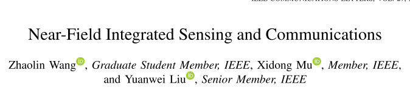
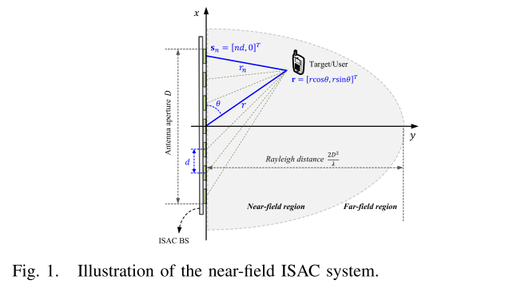
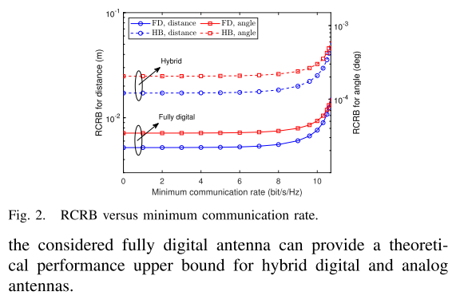
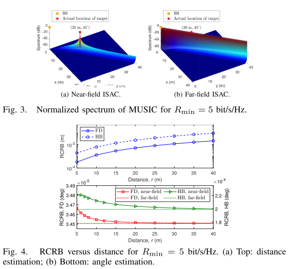

# [Good Article Sharing] Near-Field Integrated Sensing and Communications [with MATLAB Code]

Introduction: Integrated Sensor and Communication (ISAC) has been considered a promising technology for the sixth-generation (6G) wireless networks, where both sensing and communication functions can be performed simultaneously using the same spectrum and hardware facilities [1]. To meet the growing demand for communication and sensing performance, future ISAC systems will move towards ultra-large array antennas (ELAA) and high-frequency directions, such as millimeter wave (mmWave) and terahertz (THz), which are crucial for high communication capacity and high sensing resolution [1], [2]. However, this trend will significantly change the electromagnetic characteristics of the wireless environment, from plane wave propagation to spherical wave propagation, leading to inevitable near-field effects [3], [4], [5]. Therefore, existing ISAC designs relying on far-field assumptions [6], [7], [8] may not match with the real wireless environment, necessitating redesign of ISAC.
Moreover, near-field effects also offer new possibilities. The spherical wave propagation in near-field introduces a new dimension of distance, which could facilitate joint estimation of distance and angle in sensing and reduce interference in communication [9]. To the best of the authors' knowledge, near-field ISAC systems have not been studied, prompting this work. This paper proposes a near-field ISAC framework. Based on spherical wave propagation theory, an accurate near-field channel model for near-field ISAC is established.
For both fully digital antennas and hybrid digital-analog antennas, we jointly optimize ISAC signals to maximize near-field communication rate while minimizing near-field perception performance. Finally, numerical simulations validate the effectiveness of the proposed method.
Figures
Conclusion presents a near-field ISAC framework. Results indicate that ISAC systems can benefit more from near-field than from far-field. Therefore, exploring methods to expand the near-field area of ISAC systems without significantly changing the number of antennas and frequency is an interesting direction for future research.

## Images

<!-- PAYMENT_BLOCK -->

## Get this dataset

- Payment link (Stripe): [Buy now](https://buy.stripe.com/3cs8yP7sY87d0vu9AB)
- Payment QR code: 

<!-- /PAYMENT_BLOCK -->
